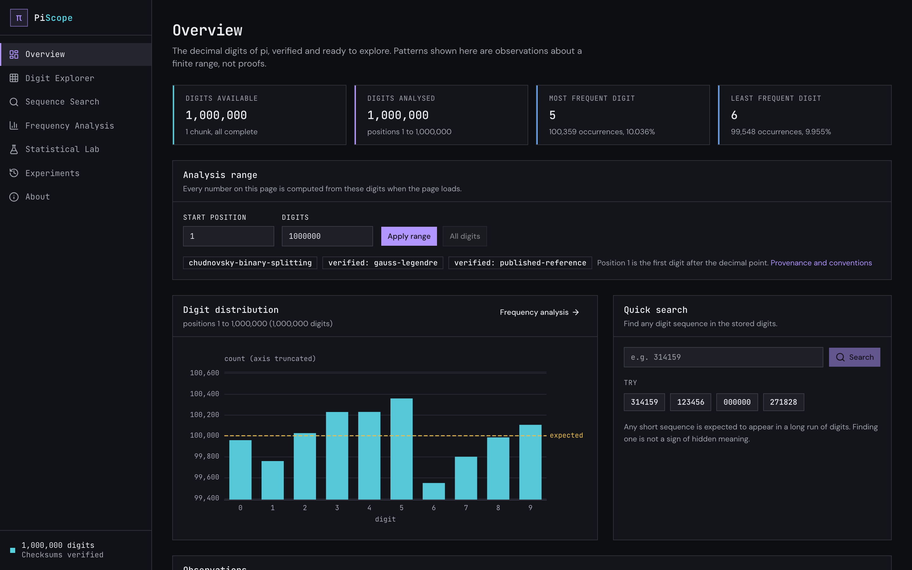

# PiScope

**Status: ACTIVE**

An interactive environment for exploring the decimal digits of pi: read them, search
them, count them, test them statistically and compare them with simulated random
sequences. Every number on screen is computed from verified digits when you ask for it.



PiScope is deliberately careful about what it claims. The normality of pi has not been
proven, and nothing a program finds in finitely many digits can prove it. The interface
separates descriptions from hypothesis tests, corrects for multiple testing, and says so
when a striking pattern is exactly what chance predicts. See
[mathematics and limitations](docs/mathematics.md).

## What it does

- **Overview**: dataset size and provenance, digit distribution, computed observations
  and recent experiments for any range of digits.
- **Digit Explorer**: page through the expansion, jump to a position, inspect single
  digits and highlight sequences.
- **Sequence Search**: every occurrence of any digit sequence, with first position, total
  count, gaps between occurrences and scan time. Results are paged.
- **Frequency Analysis**: digit counts against a uniform model, n-gram tables for lengths
  1 to 6, a pair heatmap, digit concentration by window and runs of repeated digits.
- **Statistical Lab**: chi-square, Shannon entropy, autocorrelation (Ljung-Box), runs and
  n-gram block tests, each with its statistic, expectation, p-value, sample size,
  interpretation, assumptions and limitations. A second tab compares pi with seeded,
  reproducible random sequences.
- **Experiments**: a log of what was run, with the parameters needed to repeat it.

Position 1 is the first digit after the decimal point. The leading 3 is not stored and
has no position.

## Quick start

With Docker:

```bash
docker compose up --build
```

Then open <http://localhost:3000>. The first start generates the first million digits
with the Chudnovsky algorithm, verifies them against an independent Gauss-Legendre
computation and a published checksum, and stores them in a volume. That takes about a
second. The API and its interactive documentation are at
<http://localhost:8000/api/v1/docs>.

Without Docker you need [uv](https://docs.astral.sh/uv/), Node 22 and pnpm:

```bash
uv sync --all-packages --all-extras
uv run piscope-digits generate          # first million digits, verified
uv run piscope-api                      # API on http://localhost:8000

cd frontend
pnpm install
pnpm dev                                # interface on http://localhost:3000
```

[docs/development.md](docs/development.md) covers tests, configuration and larger
datasets.

## How it is built

```text
frontend/   Next.js, TypeScript, Tailwind, shadcn/ui, ECharts
backend/    piscope-api: FastAPI, Pydantic, request limits, experiment log
engine/     piscope-engine: digit storage, generation, search, statistics (NumPy, SciPy)
data/       generated chunk files and manifest (not committed)
```

Dependencies point one way: frontend -> API -> engine -> files. The engine is a
standalone Python package with no web framework in it.

- Digits are stored one byte each in memory-mapped chunks of one million, each with a
  SHA-256 checksum, so a dataset of any size is read through the same code without loading
  it into memory. Expanding a dataset leaves verified chunks untouched.
- Search is a chunked scan with CPython's `bytes.find`, chosen by benchmark over NumPy,
  regex and KMP. It handles sequences that cross chunk boundaries and counts overlapping
  matches.
- Heavy requests are refused up front by configurable limits instead of being left to
  time out.
- Simulated random sequences record their seed, bit generator and NumPy version so any
  comparison can be repeated exactly.

Details, benchmarks and the reasoning behind each choice are in
[docs/architecture.md](docs/architecture.md).

## Tests

| Suite | Count | Covers |
| --- | ---: | --- |
| pytest | 274 | indexing, storage, generation, search, statistics, API |
| Vitest | 117 | formatting, API client, components, pages against recorded API responses |
| Playwright | 40 | the running application, checked against a published digit file |

```bash
uv run pytest
cd frontend && pnpm test && pnpm test:e2e
```

## Documentation

- [Architecture](docs/architecture.md): layers, storage format, algorithms, API, benchmarks.
- [Mathematics and limitations](docs/mathematics.md): normality, the tests used, multiple
  testing, and what finite observations cannot show.
- [Development](docs/development.md): setup, commands, configuration, larger datasets.

## Licence

[MIT](LICENSE)
